# Project 4 — End-to-End DevOps CI/CD Capstone

Automated pipeline for a Dockerized Flask app on **AWS EKS**, orchestrated by **Jenkins**: CI and image scanning, infrastructure (Terraform), configuration (Ansible), deployment (Kubernetes), and observability (Prometheus/Grafana).

| Evaluation (per [docs/task.md](docs/task.md)) | Weight |
|-----------------------------------------------|--------|
| Implementation | 75% |
| Documentation | 15% |
| Cost optimization | 10% |

**Region:** `ap-south-1` · **Requirements:** [docs/task.md](docs/task.md)

---

## Architecture

<<<<<<< ours
High-level diagram and IAM boundaries: **[docs/architecture.md](docs/architecture.md)** (Mermaid: GitHub → Jenkins → ECR / Terraform / EKS / monitoring).

---

## Project goals (task mapping)

| Goal | Delivery | Documentation |
|------|----------|---------------|
| Architecture (LB, orchestration, monitoring) | VPC, EKS, LoadBalancer Service, Prometheus/Grafana | [architecture.md](docs/architecture.md) |
| Terraform (VPC, subnets, EKS, S3 state) | `terraform/` + Jenkins Terraform stages | [terraform.md](docs/terraform.md) |
| Ansible configuration | `ansible/` after Terraform | [ansible.md](docs/ansible.md) |
| App on EKS (scale, resilience) | `kubernetes/` — probes, HPA | [kubernetes.md](docs/kubernetes.md) |
| Jenkins CI/CD | [jenkins/Jenkinsfile](jenkins/Jenkinsfile) | [pipeline.md](docs/pipeline.md), [jenkins.md](docs/jenkins.md) |
| Prometheus & Grafana | `monitoring/` — app + node metrics | [monitoring.md](docs/monitoring.md) |

---

## Jenkins pipeline (current)

Declarative pipeline: [jenkins/Jenkinsfile](jenkins/Jenkinsfile). **Sprint 7** runs CI and image scan **before** Terraform so tests fail fast and vulnerable images never reach ECR. Details: [sprint-7.md](docs/sprint-7.md).

| Capstone stage ([task.md](docs/task.md)) | Jenkins stages |
|------------------------------------------|----------------|
| **1. Build** | Test → Build image → **Scan image (Trivy)** → Push to ECR |
| **2. Infrastructure** | Terraform Init → Plan → Apply *(only if plan has changes)* |
| **3. Configuration** | Ansible Configure |
| **4. Deployment** | Deploy → Post-deploy smoke test |
| **5. Test & monitor** | Monitoring → Pipeline validation |

**Trigger:** Git push or SCM poll (~15 min) — [jenkins-triggers.md](docs/jenkins-triggers.md).

```
Checkout → Test → Build → Scan → Push ECR → Terraform → Ansible → Deploy → Smoke → Monitoring → Validation
```

---

## Repository layout

```
app/           # Flask app, Dockerfile, pytest
terraform/     # VPC, EKS, S3 backend, IAM
ansible/       # Playbooks (Jenkins CI host)
jenkins/       # Jenkinsfile
kubernetes/    # Deployment, Service, HPA
monitoring/    # Prometheus, Grafana, kube-state-metrics, node-exporter
docs/          # Runbooks, sprint logs, screenshots
```

---

## Sprint summary

| Sprint | Topic | Log |
|--------|--------|-----|
| 1 | Docker, ECR, Jenkins on EC2 | [sprint-1.md](docs/sprint-1.md) |
| 2 | Terraform + remote state + Jenkins | [terraform.md](docs/terraform.md) |
| 3 | Ansible after Terraform | [ansible.md](docs/ansible.md) |
| 4 | Deploy to EKS (LB, HPA, smoke test) | [pipeline.md](docs/pipeline.md) |
| 5 | Prometheus, Grafana, alerts | [monitoring.md](docs/monitoring.md) |
| 6 | E2E tests, cost doc, demo script | [sprint-6.md](docs/sprint-6.md) |
| 7 | Fail-fast CI, Trivy, conditional Terraform apply | [sprint-7.md](docs/sprint-7.md) |

---

## Evidence screenshots

### Sprint 1 — Docker, ECR, Jenkins


### Sprint 2 — Terraform (VPC + EKS)


=======
```
Developer --push--> GitHub --webhook/poll--> Jenkins (EC2)
                                                 |
        ------------------------------------------------------------------
        |              |              |              |                 |
   Test/Scan/ECR    Terraform      Ansible        Deploy          Monitoring
        |          (VPC/EKS/S3)    (host cfg)    (kubectl)      (Prom/Grafana)
        v                                                            |
      ECR ----------------------------------------------------> EKS pods
```

Network, IAM, and components: [docs/architecture.md](docs/architecture.md).

---

## Project goals (task mapping)

| Goal | Delivery | Documentation |
|------|----------|---------------|
| Architecture (LB, orchestration, monitoring) | VPC, EKS, LoadBalancer Service, Prometheus/Grafana | [architecture.md](docs/architecture.md) |
| Terraform (VPC, subnets, EKS, S3 state) | `terraform/` + Jenkins Terraform stages | [terraform.md](docs/terraform.md) |
| Ansible configuration | `ansible/` runs after Terraform | [ansible.md](docs/ansible.md) |
| App on EKS (scale, resilience) | `kubernetes/` — probes, HPA | [kubernetes.md](docs/kubernetes.md) |
| Jenkins CI/CD | [jenkins/Jenkinsfile](jenkins/Jenkinsfile) | [pipeline.md](docs/pipeline.md), [jenkins.md](docs/jenkins.md) |
| Prometheus & Grafana | `monitoring/` — app + node metrics | [monitoring.md](docs/monitoring.md) |

---

## Jenkins pipeline

Single declarative pipeline: [jenkins/Jenkinsfile](jenkins/Jenkinsfile).

| Capstone stage ([task.md](docs/task.md)) | Jenkins stages |
|------------------------------------------|----------------|
| **1. Build** | Test → Build image → Scan image (Trivy) → Push to ECR |
| **2. Infrastructure** | Terraform Init → Plan → Apply (includes `terraform validate`; apply runs only when the plan has changes) |
| **3. Configuration** | Ansible Configure |
| **4. Deployment** | Deploy → Post-deploy smoke test |
| **5. Test & monitor** | Monitoring → Pipeline validation |

**Trigger:** Git push or SCM poll every 15 minutes — [jenkins-triggers.md](docs/jenkins-triggers.md).

```
Checkout → Test → Build → Scan → ECR → Terraform → Ansible → Deploy → Smoke → Monitoring → Validation
```

CI stages run first, so a failing test or a CRITICAL vulnerability stops the run before any infrastructure is touched ([sprint-7.md](docs/sprint-7.md)).

---

## Repository layout

```
app/           # Flask app, Dockerfile, pytest
terraform/     # VPC, EKS, S3 backend, IAM
ansible/       # Playbooks (Jenkins CI host)
jenkins/       # Jenkinsfile
kubernetes/    # Deployment, Service, HPA
monitoring/    # Prometheus, Grafana, kube-state-metrics, node-exporter
docs/          # Runbooks, sprint logs, task requirements
```
>>>>>>> theirs

### Sprint 3 — Ansible

<<<<<<< ours
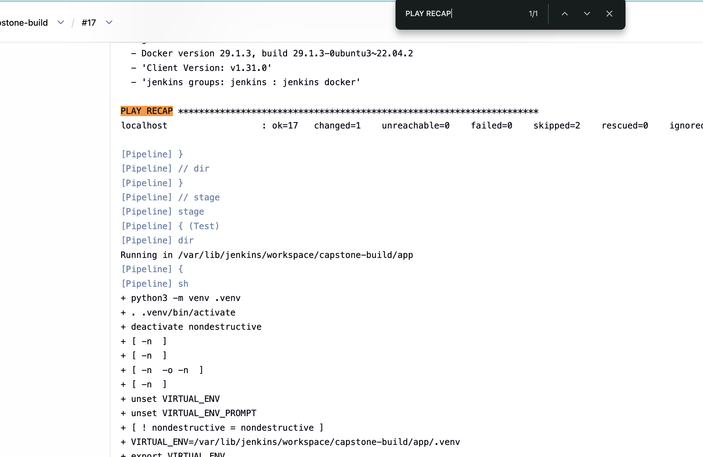
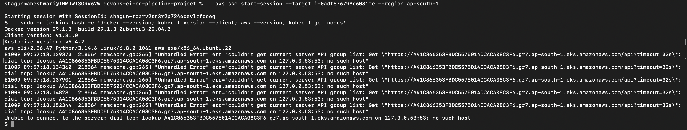

### Sprint 4 — Deploy to EKS

=======
## Sprint summary

| Sprint | Topic | Log |
|--------|--------|-----|
| 1 | Docker, ECR, Jenkins on EC2 | [sprint-1.md](docs/sprint-1.md) |
| 2 | Terraform + remote state + Jenkins | [terraform.md](docs/terraform.md) |
| 3 | Ansible after Terraform | [ansible.md](docs/ansible.md) |
| 4 | Deploy to EKS (LB, HPA, smoke test) | [pipeline.md](docs/pipeline.md) |
| 5 | Prometheus, Grafana, alerts | [monitoring.md](docs/monitoring.md) |
| 6 | E2E tests, cost doc, demo script | [sprint-6.md](docs/sprint-6.md) |
| 7 | Hardening: fail-fast CI, Trivy scan, conditional apply | [sprint-7.md](docs/sprint-7.md) |

## Evidence screenshots

### Sprint 1 — Docker, ECR, Jenkins


### Sprint 2 — Terraform (VPC + EKS)


### Sprint 3 — Ansible


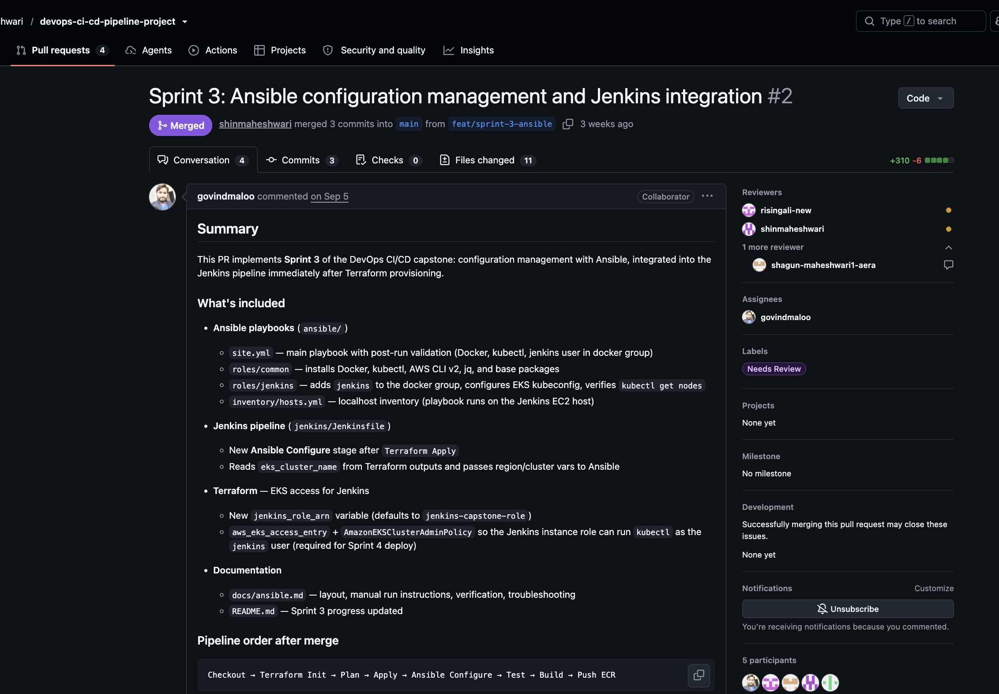

### Sprint 4 — Deploy to EKS
>>>>>>> theirs
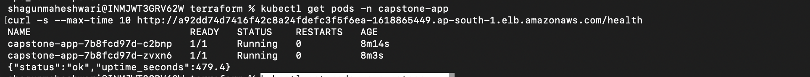
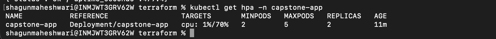
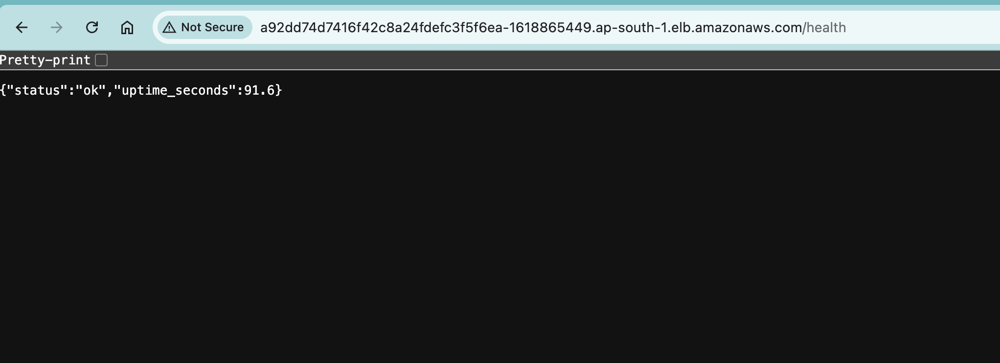
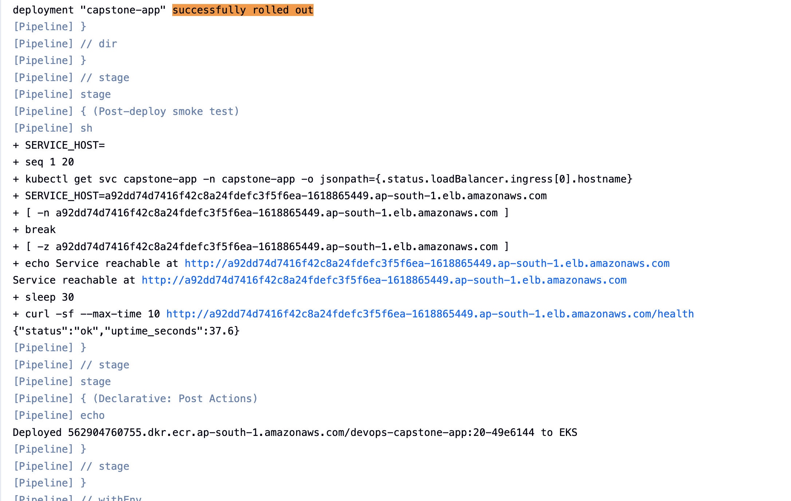
<<<<<<< ours

### Sprint 5 — Monitoring and alerting

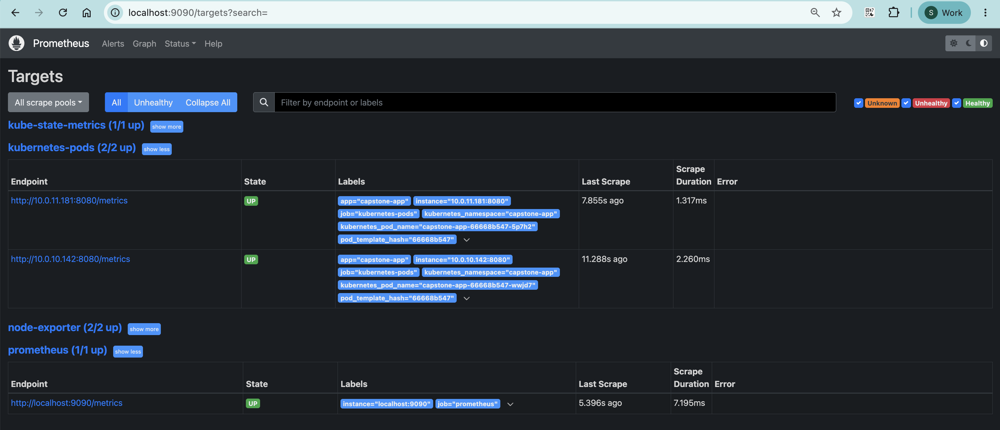
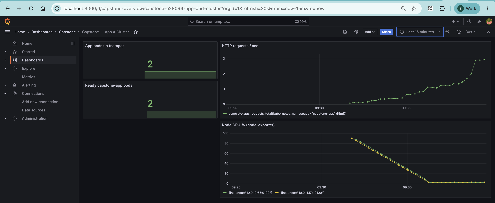
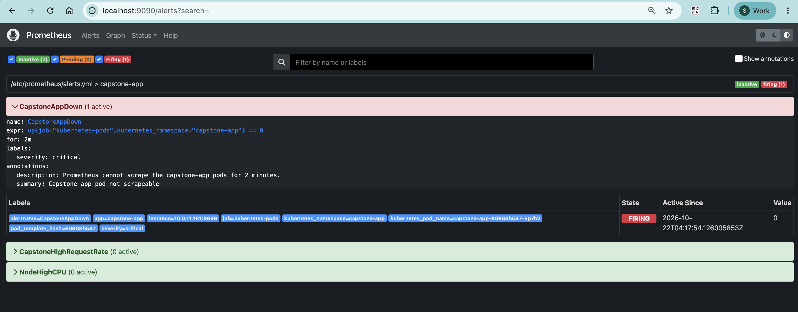
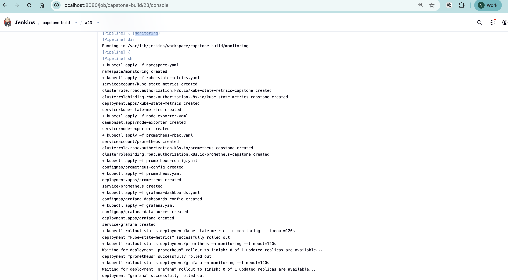
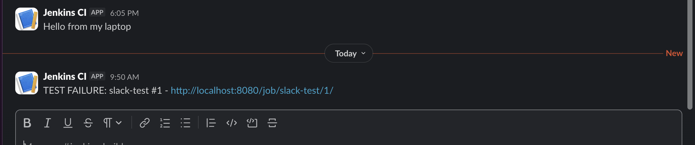

### Sprint 6 — Full pipeline

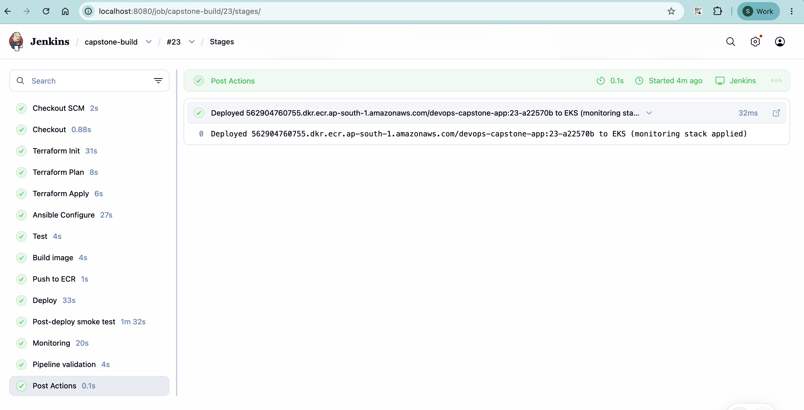

### Sprint 7 — Post-review hardening

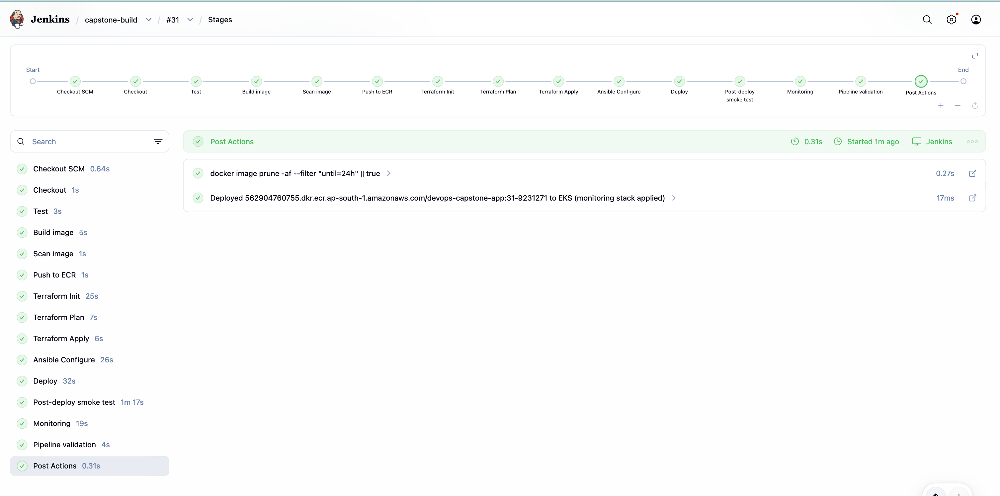
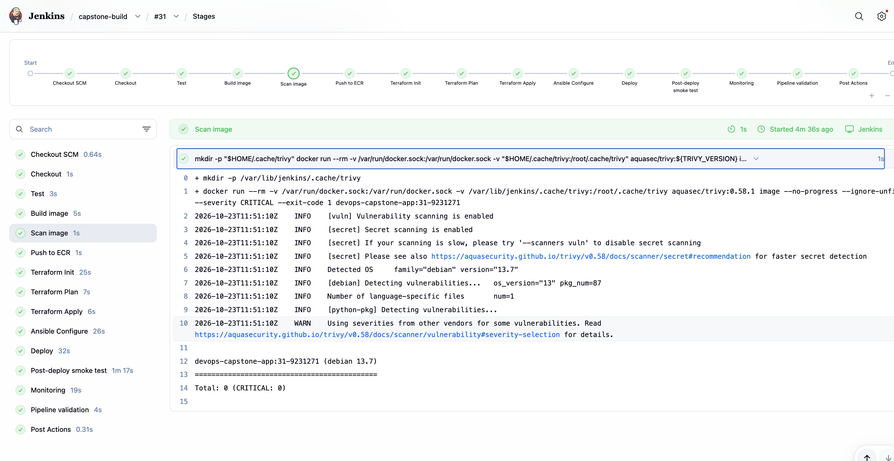
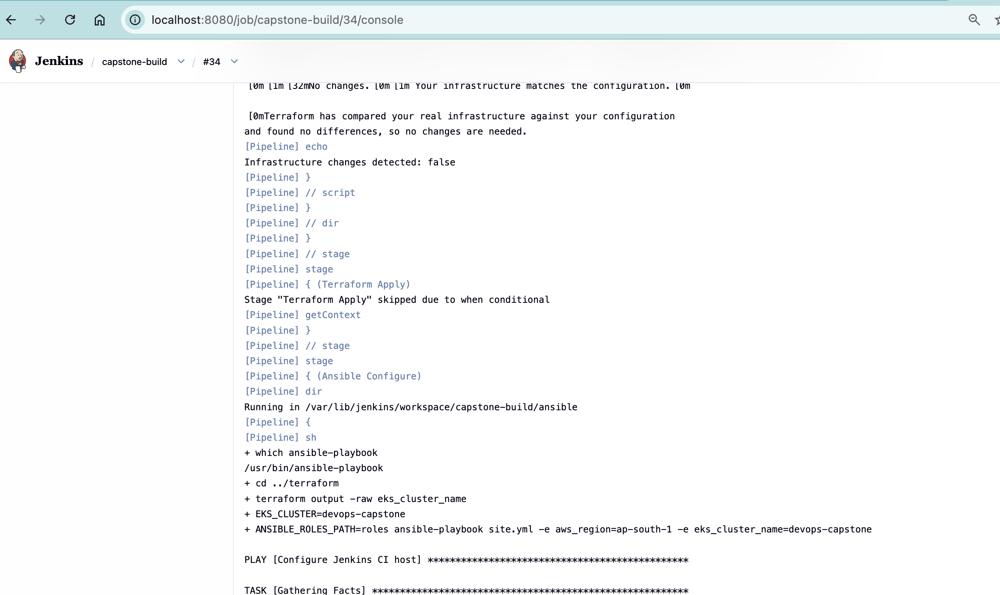
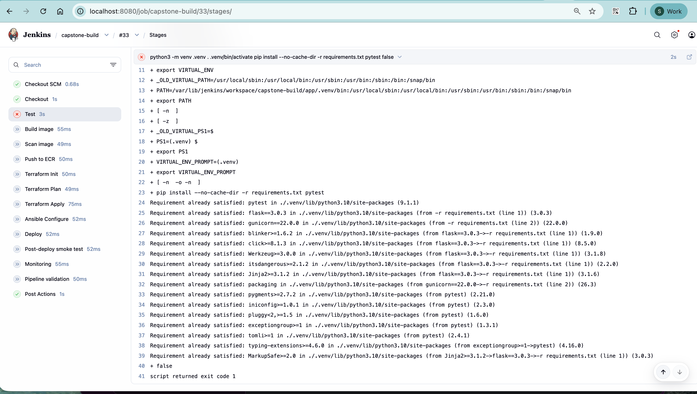
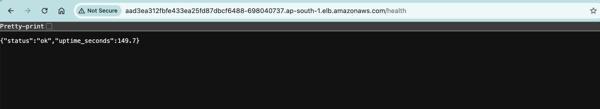

More filenames: [docs/screenshots/README.md](docs/screenshots/README.md).

---

## Step-by-step — run the project

### Prerequisites

- AWS account (EKS, ECR, VPC, S3, DynamoDB)
- Jenkins on EC2 — build and access: **[docs/jenkins.md](docs/jenkins.md)**
- Job: **Pipeline from SCM**, script path `jenkins/Jenkinsfile`, branch `*/main`
- ECR repo `devops-capstone-app` and Terraform S3 backend — [terraform.md](docs/terraform.md)
- Jenkins credential `slack-webhook-url` (optional, for failure alerts) — [monitoring.md](docs/monitoring.md)

### 1. Local app

```bash
cd app
docker build -t app:local .
docker run -p 8080:8080 app:local
curl http://localhost:8080/health
pytest -q
```

### 2. Full pipeline on Jenkins

Push to `main` or run the job manually. Confirm all stages through **Pipeline validation** (see [e2e-testing.md](docs/e2e-testing.md)).

### 3. Infrastructure

```bash
cd terraform && terraform init && terraform validate
aws eks describe-cluster --name devops-capstone --region ap-south-1 --query cluster.status
kubectl get nodes
```

Teardown when idle: `terraform destroy` — [cost-optimization.md](docs/cost-optimization.md).

### 4. Application on EKS

```bash
kubectl get deploy,svc,hpa -n capstone-app
APP=$(kubectl get svc capstone-app -n capstone-app -o jsonpath='{.status.loadBalancer.ingress[0].hostname}')
curl -sf "http://${APP}/health"
curl -sf "http://${APP}/metrics" | head
```

Rollback: [pipeline.md](docs/pipeline.md) · Manifests: [kubernetes.md](docs/kubernetes.md).

### 5. Monitoring

```bash
kubectl get pods -n monitoring
kubectl port-forward svc/grafana -n monitoring 3000:80
kubectl port-forward svc/prometheus -n monitoring 9090:9090
```
=======

### Sprint 5 — Monitoring and alerting


### Sprint 6 — Full pipeline


### Sprint 7 — Hardening

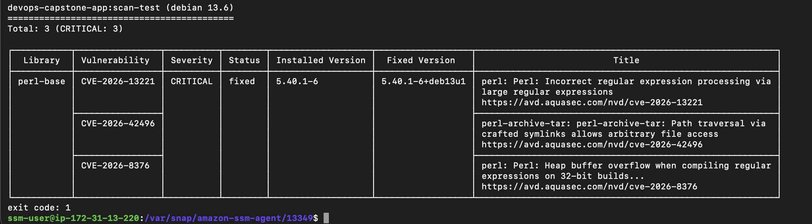


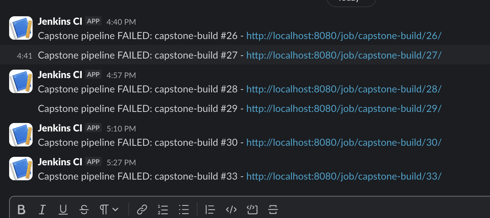
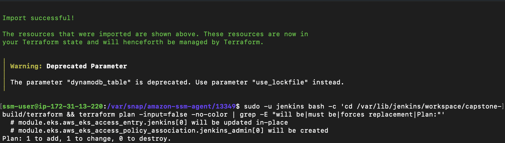

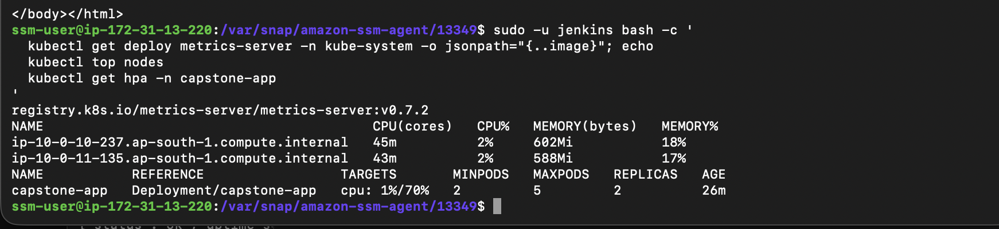

Checklist of expected files: [docs/screenshots/README.md](docs/screenshots/README.md).

---

## Step-by-step — run the project

### Prerequisites

- AWS account (EKS, ECR, VPC, S3, DynamoDB)
- Jenkins on EC2 with **Pipeline from SCM**, script path `jenkins/Jenkinsfile`, branch `*/main`
- ECR repository `devops-capstone-app` and Terraform S3 backend (see [terraform.md](docs/terraform.md))
- Jenkins setup and access: [sprint-1.md](docs/sprint-1.md)

### 1. Local app

```bash
cd app
docker build -t app:local .
docker run -p 8080:8080 app:local
curl http://localhost:8080/health
pytest -q
```

### 2. Full pipeline on Jenkins

Push to `main` (or run job manually). Confirm all stages complete through **Pipeline validation**.

Failure alert: Jenkins credential `slack-webhook-url` (Secret text) — [monitoring.md](docs/monitoring.md).

### 3. Infrastructure

The first pipeline run creates the cluster (about 15 minutes). Jenkins is the cluster creator, so EKS grants its role admin automatically. To use `kubectl` from your laptop, give your IAM principal an access entry once:

```bash
aws eks create-access-entry --cluster-name devops-capstone --principal-arn <your-iam-arn> --region ap-south-1
aws eks associate-access-policy --cluster-name devops-capstone --principal-arn <your-iam-arn> \
  --policy-arn arn:aws:eks::aws:cluster-access-policy/AmazonEKSClusterAdminPolicy \
  --access-scope type=cluster --region ap-south-1
aws eks update-kubeconfig --name devops-capstone --region ap-south-1
```

If you create the cluster from a laptop instead, run `terraform apply -var jenkins_role_arn=arn:aws:iam::<account-id>:role/jenkins-capstone-role` so Jenkins also gets access ([terraform.md](docs/terraform.md)).

```bash
cd terraform && terraform init && terraform validate
aws eks describe-cluster --name devops-capstone --region ap-south-1 --query cluster.status
kubectl get nodes
```

Teardown when not in use: disable the Jenkins job, delete the load balancer Service, then `terraform destroy` — [cost-optimization.md](docs/cost-optimization.md).

### 4. Application on EKS

```bash
kubectl get deploy,svc,hpa -n capstone-app
APP=$(kubectl get svc capstone-app -n capstone-app -o jsonpath='{.status.loadBalancer.ingress[0].hostname}')
curl -sf "http://${APP}/health"
curl -sf "http://${APP}/metrics" | head
```

Rollback: [pipeline.md](docs/pipeline.md).

### 5. Monitoring

```bash
kubectl get pods -n monitoring
kubectl port-forward svc/grafana -n monitoring 3000:80      # http://localhost:3000
kubectl port-forward svc/prometheus -n monitoring 9090:9090  # http://localhost:9090/targets
```

Grafana (dev, port-forward only): `admin` / `capstone-dev` — dashboard **Capstone — App & Cluster**.  
Prometheus targets should include app pods, kube-state-metrics, and node-exporter.

Full checklist: [e2e-testing.md](docs/e2e-testing.md).

### 6. Demo / viva

[docs/demo-script.md](docs/demo-script.md) — 5–10 minute walkthrough of all five capstone stages.
>>>>>>> theirs

Grafana (dev): `admin` / `capstone-dev` — dashboard **Capstone — App & Cluster**.

<<<<<<< ours
### 6. Demo / viva

[docs/demo-script.md](docs/demo-script.md) — walkthrough of all five capstone stages (map Sprint 7 Jenkins order to each stage verbally).

---

## Documentation index

| Topic | File |
|-------|------|
| Capstone requirements | [docs/task.md](docs/task.md) |
| Architecture & IAM | [docs/architecture.md](docs/architecture.md) |
| Jenkins server setup & troubleshooting | [docs/jenkins.md](docs/jenkins.md) |
| Sprint 1 log | [docs/sprint-1.md](docs/sprint-1.md) |
| Terraform & EKS | [docs/terraform.md](docs/terraform.md) |
| Ansible | [docs/ansible.md](docs/ansible.md) |
| Deploy pipeline | [docs/pipeline.md](docs/pipeline.md) |
| Kubernetes manifests | [docs/kubernetes.md](docs/kubernetes.md) |
| Monitoring & alerts | [docs/monitoring.md](docs/monitoring.md) |
| Jenkins triggers | [docs/jenkins-triggers.md](docs/jenkins-triggers.md) |
| End-to-end testing | [docs/e2e-testing.md](docs/e2e-testing.md) |
| Cost optimization (10%) | [docs/cost-optimization.md](docs/cost-optimization.md) |
| Sprint 6 sign-off | [docs/sprint-6.md](docs/sprint-6.md) |
| Sprint 7 improvements | [docs/sprint-7.md](docs/sprint-7.md) |
| Screenshot checklist | [docs/screenshots/README.md](docs/screenshots/README.md) |

---

## Deliverables (Project 4)

- End-to-end Jenkins pipeline — build/scan, Terraform, Ansible, deploy, test, monitoring
- AWS infrastructure via Terraform — VPC, EKS, S3 state (Jenkins EC2 documented in [jenkins.md](docs/jenkins.md) / [terraform.md](docs/terraform.md))
- Ansible configuration management in pipeline
- Application on EKS with health checks and HPA
- Prometheus, Grafana, and alert rules (Slack on pipeline failure)
- Documentation, cost guide, demo script, and evidence screenshots

---

## Cost notes

Single NAT, `t3.medium` nodes, destroy EKS between study sessions. **[docs/cost-optimization.md](docs/cost-optimization.md)**

---

## Lessons learned (summary)

- **IAM instance profiles** — no AWS keys in git ([sprint-1.md](docs/sprint-1.md))
- **SSM port-forward** — Jenkins access behind corporate proxy ([jenkins.md](docs/jenkins.md))
- **EKS IAM** — caller vs cluster service roles ([terraform.md](docs/terraform.md))
- **metrics-server** — required for HPA CPU metrics ([pipeline.md](docs/pipeline.md))
- **Fail-fast + Trivy** — CI before Terraform; block CRITICAL CVEs ([sprint-7.md](docs/sprint-7.md))

Full troubleshooting in sprint logs under `docs/`.
=======
## Documentation index

| Topic | File |
|-------|------|
| Capstone requirements | [docs/task.md](docs/task.md) |
| Architecture & IAM | [docs/architecture.md](docs/architecture.md) |
| Jenkins & ECR setup | [docs/sprint-1.md](docs/sprint-1.md) |
| Terraform & EKS | [docs/terraform.md](docs/terraform.md) |
| Ansible | [docs/ansible.md](docs/ansible.md) |
| Deploy pipeline | [docs/pipeline.md](docs/pipeline.md) |
| Kubernetes manifests | [docs/kubernetes.md](docs/kubernetes.md) |
| Monitoring & alerts | [docs/monitoring.md](docs/monitoring.md) |
| Jenkins setup and troubleshooting | [docs/jenkins.md](docs/jenkins.md) |
| Jenkins triggers | [docs/jenkins-triggers.md](docs/jenkins-triggers.md) |
| End-to-end testing | [docs/e2e-testing.md](docs/e2e-testing.md) |
| Cost optimization (10%) | [docs/cost-optimization.md](docs/cost-optimization.md) |
| Production readiness | [docs/sprint-6.md](docs/sprint-6.md) |
| Pipeline hardening (Sprint 7) | [docs/sprint-7.md](docs/sprint-7.md) |
| Screenshot list | [docs/screenshots/README.md](docs/screenshots/README.md) |

---

## Deliverables (Project 4)

- End-to-end Jenkins pipeline — build, Terraform, Ansible, deploy, test, monitoring
- AWS infrastructure via Terraform — VPC, EKS, S3 state (Jenkins EC2 bootstrap documented in [terraform.md](docs/terraform.md))
- Ansible configuration management in pipeline
- Application on EKS with health checks and HPA
- Prometheus, Grafana, and Prometheus alert rules
- Documentation, cost guide, and demo script

---

## Cost notes

Single NAT, `t3.medium` nodes, destroy EKS between study sessions. Disable the Jenkins job while the cluster is down, because polling plus `terraform apply` would recreate it. Details: [docs/cost-optimization.md](docs/cost-optimization.md).

---

## Lessons learned

- **IAM instance profiles** — Jenkins uses EC2 role, not committed access keys
- **SSM port-forward** — access Jenkins when corporate network blocks SSH/8080 ([sprint-1.md](docs/sprint-1.md))
- **EKS IAM** — caller permissions differ from cluster service roles ([terraform.md](docs/terraform.md))
- **metrics-server** — required on EKS for meaningful HPA CPU metrics ([pipeline.md](docs/pipeline.md))
- **Fail fast** — tests and the image scan run before Terraform, so a bad commit never touches infrastructure ([sprint-7.md](docs/sprint-7.md))
- **EKS creator access** — the cluster creator gets an automatic admin access entry, so an explicit entry for the same principal conflicts ([sprint-7.md](docs/sprint-7.md))
- **Never abort Terraform Apply** — an interrupted apply can leave a cluster outside state ([sprint-7.md](docs/sprint-7.md))

More detail in each sprint log under `docs/`.
>>>>>>> theirs
